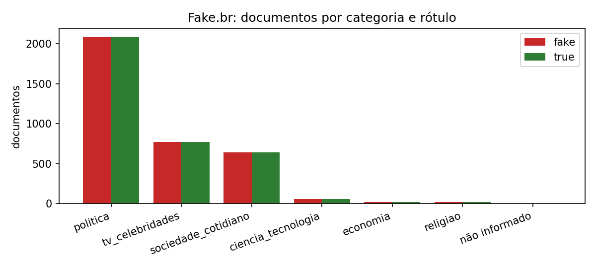
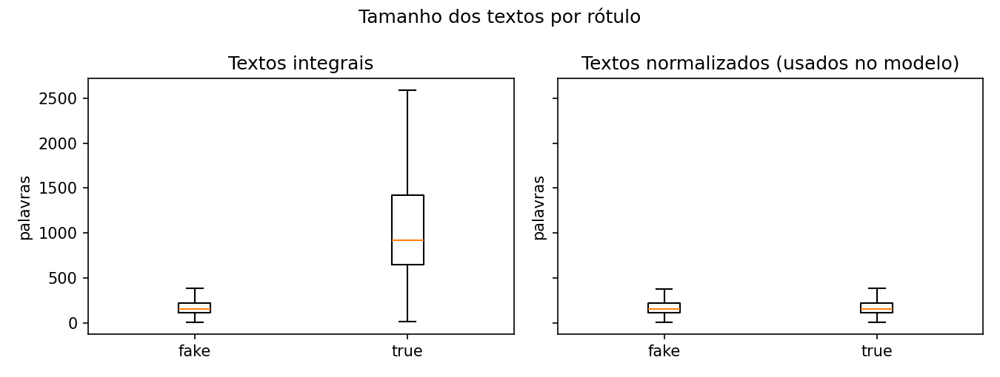
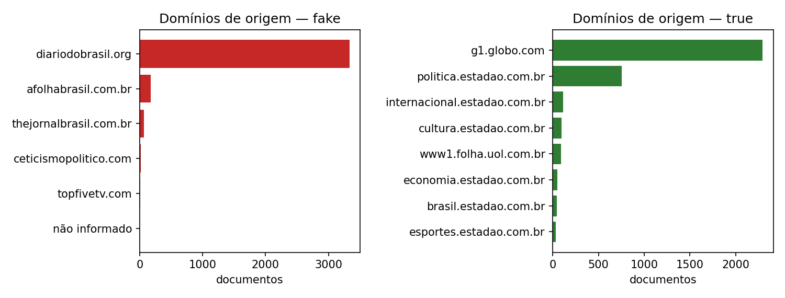
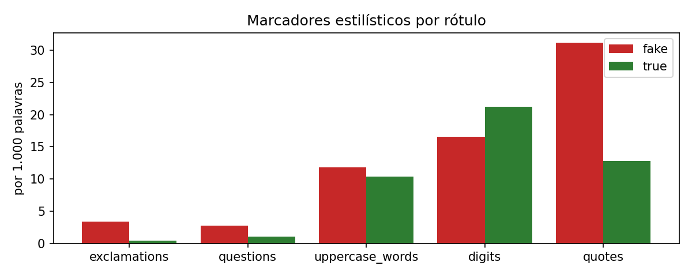

# Análise exploratória dos dados (EDA)

EDA dos 7.199 documentos do Fake.br usados pelo [modelo de IA](modelo-ia.md), após a mesma deduplicação do experimento, e do corpus local de 139 frases do produto. É reproduzível no repositório da aplicação:

```bash
cd experiments/fakebr
python -m source.eda   # baixa o snapshot oficial, confere o SHA-256 e gera results/eda_summary.json e figures/eda_*.png
```

O corpus não é republicado (o snapshot não tem licença explícita); só estatísticas agregadas ficam no repositório.

## Principais achados

| Achado | Evidência | Consequência |
|:---|:---|:---|
| Classes balanceadas | 3.600 fake e 3.599 true, também dentro de cada categoria e partição | Acurácia é uma métrica adequada; a classe majoritária acerta 50% |
| Tamanho separaria as classes | Textos integrais: média de 1.107 palavras nas verdadeiras e 186 nas falsas | O modelo usa a versão normalizada (183 contra 186 palavras) |
| Viés de veículo | Falsas vêm de 6 domínios (92,6% de um único site); verdadeiras de 25 (G1 e Estadão); nenhum domínio em comum | Parte do sinal pode ser estilo de redação do veículo |
| Época diferente | Falsas em 2016-2017; verdadeiras em 2017-2018 | Nomes e eventos do período também separam as classes |
| Marcadores de estilo | Por mil palavras: 3,39 contra 0,41 exclamações; 31,2 contra 12,8 aspas | Sinais estilísticos fortes, não factuais |
| Temas concentrados | Política, TV/celebridades e sociedade somam mais de 97% | Pouca evidência para ciência, economia e religião |

## Distribuições









## Termos característicos

Pelo log-odds com prior de Dirichlet informativo, as verdadeiras são marcadas por fórmulas de agência ("nesta quarta-feira", "tribunal", "federal", "Eldorado") e as falsas por nomes de políticos do período, linguagem coloquial ("pra", "povo") e referências ao próprio meio ("vídeo", "matéria", "site").

## Corpus local do produto

`backend/ml/datasets/training_local.csv`: 139 frases (70 fake, 69 true; 112 treino e 27 teste), média de 15 palavras, sem duplicatas. Toda a procedência está marcada como não verificada externamente; serve apenas ao baseline do classificador de contingência.

## Implicações

- Dividir por grupos e usar textos normalizados, como o experimento já faz.
- Ler a acurácia no Fake.br como medida de estilo jornalístico do período, não de veracidade; o próximo teste é com veículos não vistos no treino.
- No produto, o estado de uma alegação depende só de evidência com fonte ([ADR-006](decisoes/ADR-006-evidence-first-architecture.md)).
