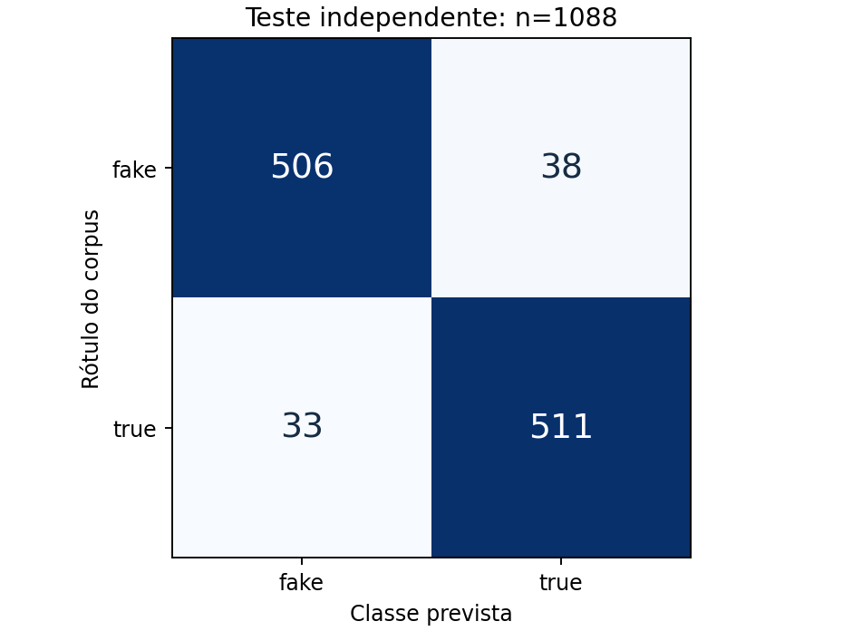
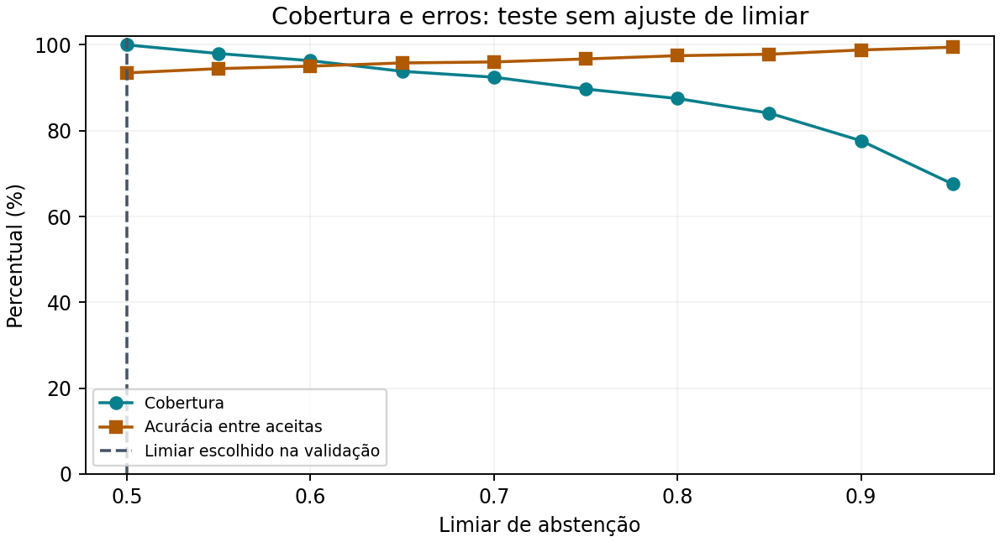

# Modelo de IA (Fake.br)

Classificador supervisionado de notícias falsas e verdadeiras em português, treinado e avaliado de forma reproduzível em [`experiments/fakebr`](https://github.com/evidencia-grupo/EvidencIA/tree/main/experiments/fakebr). O relatório técnico completo está em [`relatorio_tecnico.md`](https://github.com/evidencia-grupo/EvidencIA/blob/main/experiments/fakebr/relatorio_tecnico.md).

!!! warning "Escopo"
    O modelo mede padrões de linguagem de notícias de 2016 a 2018, não a veracidade de uma alegação. No produto ele **não decide** o estado de nenhuma alegação: isso depende só de evidências com fonte ([ADR-006](decisoes/ADR-006-evidence-first-architecture.md)).

Mapa das páginas de IA: esta página é a fonte canônica do experimento acadêmico Fake.br; [Classificador de Contingência](avaliacao-classificador-ml.md) cobre o baseline de 27 exemplos usado no backend; [Pipeline de IA e Datasets](ia-e-datasets.md) descreve provedores, datasets e recuperação de evidências; [Revisão do relatório de IA](../governanca/revisao-relatorio-ia.md) registra a conferência da entrega recebida. As métricas destas páginas são de corpora acadêmicos e não medem o funcionamento do produto de ponta a ponta.

## Abordagem

- **Dados:** Fake.br, snapshot fixado e conferido por SHA-256; 7.199 notícias após deduplicação, divididas por grupos temáticos (60/15/10/15% em treino, validação, calibração e teste; semente 42). Veja a [EDA](eda.md).
- **Representação:** TF-IDF de palavras e bigramas ajustado só no treino.
- **Seleção:** Naive Bayes (baseline) e regressão logística (C = 1 e C = 4), pelo macro-F1 na validação. Escolhida: regressão logística, C = 4.
- **Calibração:** sigmoid em partição própria de 717 notícias.
- **Abstenção:** limiar escolhido na validação e proteção para vocabulário insuficiente.

## Resultados no teste (1.088 notícias)

| Modelo | Acurácia | Macro-F1 | ROC-AUC | Brier |
|:---|:---:|:---:|:---:|:---:|
| Classe majoritária | 50,00% | 0,3333 | 0,5000 | 0,2500 |
| Naive Bayes (baseline) | 89,06% | 0,8906 | 0,9597 | 0,0857 |
| Regressão logística calibrada | **93,47%** | **0,9347** | **0,9842** | **0,0474** |
| Mesma, só 40 primeiras palavras | 83,82% | 0,8382 | 0,9283 | 0,1098 |

IC95% da acurácia (bootstrap por grupos): 92,00% a 94,94%. A calibração reduziu o ECE de 0,1155 para 0,0112.



| Rótulo do corpus | Previsto `fake` | Previsto `true` | Total |
|:---|:---:|:---:|:---:|
| `fake` | 506 | 38 | 544 |
| `true` | 33 | 511 | 544 |



Curva no teste, sem ajuste de limiar (fonte: `test_threshold_curve` em `experiments/fakebr/results/metrics.json`). O limiar escolhido na validação foi 0,50, ou seja, sem abstenção.

| Limiar | Aceitas (de 1.088) | Cobertura | Acurácia entre aceitas |
|:---:|:---:|:---:|:---:|
| 0,50 | 1.088 | 100,0% | 93,47% |
| 0,55 | 1.066 | 98,0% | 94,47% |
| 0,60 | 1.048 | 96,3% | 95,04% |
| 0,65 | 1.021 | 93,8% | 95,79% |
| 0,70 | 1.006 | 92,5% | 96,02% |
| 0,75 | 976 | 89,7% | 96,72% |
| 0,80 | 952 | 87,5% | 97,48% |
| 0,85 | 915 | 84,1% | 97,81% |
| 0,90 | 845 | 77,7% | 98,82% |
| 0,95 | 735 | 67,6% | 99,46% |

## Limitações

- **Viés de veículo e época:** 93% das falsas vêm de um único site e nenhum domínio aparece nas duas classes; parte da acurácia pode vir do estilo do veículo.
- **Textos curtos:** com 40 palavras a acurácia cai para 83,82%; legendas de vídeo são faladas, curtas e de outros temas.
- **Negação, ironia e números trocados** mudam o fato sem mudar o vocabulário.
- **Sem anotação humana** de pares alegação-evidência.

## Papel no produto

| Componente | Papel | Decide o estado? |
|:---|:---|:---:|
| LLM (Ollama ou provedor remoto) | Extrai alegações literais e escolhe perguntas de um catálogo fechado | Não |
| Busca de evidências (ClaimReview) | Encontra checagens publicadas por alegação | Sim, com fonte |
| Classificador linguístico de contingência | Observação de estilo quando não há evidência | Não |
| Modelo Fake.br | Experimento acadêmico | Não está no fluxo |

## Reprodução

```bash
cd experiments/fakebr
pip install -r requirements-lock.txt
python -m unittest source.test_experiment -v
```

Os testes conferem os hashes dos artefatos, a ausência de vazamento entre partições, a coerência entre métricas e predições e a concordância com a entrega original (tolerância 1e-10).
